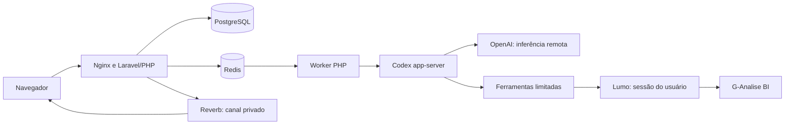

# Arquitetura

PHP é o backend principal. Node compila Vue/TypeScript e instala o binário oficial do Codex durante o build. O worker PHP fala JSON-RPC por stdio com Codex; o modelo permanece na OpenAI. Não há necessidade de GPU no servidor.

## Fronteiras

- Projetos, arquivos, conversas, canais e revisões pertencem ao usuário do portal. Todas as rotas verificam propriedade; viewer não cria nem executa tarefas.
- A conexão BI individual determina tenants e permissões. Catálogos/cache são separados por conta, sessão e tenant. Reconectar cria uma nova geração de catálogo para não reaproveitar metadados do login anterior.
- Sessão nativa Lumo é temporária por comando, com mutex por conexão. A renovação é gravada criptografada de volta no banco antes de limpar os arquivos temporários.
- As ferramentas de negócio passam pelo broker. A versão fixada também oferece `apply_patch` e utilitários nativos do protocolo; solicitações de escrita/comando são recusadas. Shell, plugins, navegador, goals e multiagente nativos são desabilitados pela configuração. Requisições nativas de aprovação de comandos/escrita são recusadas; escritas autorizadas passam pelo broker. `workspace_file` valida pastas, extensões, tamanho, symlinks e conflitos de conteúdo. Credenciais/estado interno do CLI não são expostos.
- Um mutex por projeto impede duas conversas de alterar seu workspace ao mesmo tempo. A mesma conversa admite uma tarefa ativa. Filas `actions/agents` e `documents` separam alterações/IA da extração de arquivos.
- Tokens não são armazenados em texto aberto no banco nem enviados para o navegador. A APP_KEY integra o backup criptografado. Credenciais de um login OSS local são recusadas em ambiente de produção.

Codex inicia em um diretório de execução separado do workspace Lumo, dentro do perfil privado do projeto. A descoberta de instruções do workspace está desativada; o perfil tem uma orientação controlada e as regras são lidas pelas ferramentas autorizadas. Testes com o binário real e um provedor sintético conferem o catálogo de ferramentas, a recusa de escrita e ausência de instruções locais não autorizadas. Uma nova tarefa real confirmou o contexto correto.

Esse isolamento é aplicado pelo portal e pelo broker. Não equivale a uma VM por cliente. Antes do piloto central, avalie capacidade e endurecimento de processos no host escolhido.

## Ciclo de alteração

1. Escolher tenant e aplicação ou criar um projeto.
2. Inspecionar metadados, dados e instruções; criar/editar somente rascunho.
3. Validar YAML, expressões e consultas; preparar revisão com tenant, recurso, destino e diff.
4. Pausar a tarefa e liberar o worker. A decisão humana expira e fica vinculada ao fingerprint da revisão.
5. Revalidar estado atual, papel e propriedade antes de executar uma ação autorizada. Nunca repetir automaticamente uma ação cujo resultado ficou incerto.
6. Persistir resultado confirmado e retomar IA para validação e prévia.
7. Conferir todas as fontes, agendas e teste concluído antes da publicação de uma aplicação gerenciada.

Atualizações do conjunto de ferramentas iniciam uma nova thread nativa com histórico limitado do portal, preservando a conversa e evitando retomar um schema antigo. Histórico anterior é contexto, nunca autorização de escrita.

## Atualização de dados

`RefreshCoverage` resolve aplicação → tabelas → fluxos, deduplica fontes e confere publicação, frequência, agente/contexto e atividade. Agendas diárias ou mais frequentes existentes são preservadas. Novas cargas preferem madrugada em America/Sao_Paulo.

`run_schedule` registra horário, fontes esperadas e hash da configuração. Quando o CLI não retorna run_id, a conferência aceita apenas uma execução nova correspondente no histórico. Sucesso exige término, timestamps válidos e sucesso de todas as fontes. O comprovante vale para a mesma configuração; uma mudança exige nova conferência.

## Pendências externas

- Enquadramento/configuração oficial OpenAI para hospedagem remota.
- A versão pública 7e5678d teve CI aprovado. As melhorias locais de gestão seguem em homologação antes de nova publicação.
- Instalação no servidor, certificado público, backup fora do host e piloto com usuários reais.
- Homologação adicional com uma conta BI restrita/2FA e revogação real de acesso, sem alterar permissões de clientes ativos.

## Catálogo e parâmetros

O catálogo cobre os 13 tipos aceitos por `lumo list` na versão fixada. Variáveis usam uma rota própria e expõem apenas nomes/referências; nenhum valor é enviado ao navegador ou à IA. `tenant_variables` oferece o mesmo contrato ao agente. Apresentações, cadastros e investigações usam listagem autorizada e pull do recurso, porque o comando info do Lumo não aceita esses tipos. Sem metadados de autoria, a interface informa que o resumo é parcial.

`ScheduleChanges` confere vínculos novos antes de ativar ou sincronizar uma agenda ativa. Uma fonte já coberta por outra agenda ativa deve reutilizá-la; KeySweep é tratado separadamente da carga. Um mutex por tenant serializa essas alterações entre usuários. A conferência não altera agendas preexistentes.

A preservação das agendas também impede reduzir intervalos, remover horários, desativar a agenda ou retirar fontes já cobertas diariamente. Intervalos equivalentes ou menores são aceitos quando preservam as demais condições e o fuso. Alterações de restrições que não possam ser comprovadas como equivalentes são recusadas.

A geração de login e o estado da conexão são revalidados após cada comando Lumo. Renovações e falhas de uma sessão antiga não sobrescrevem uma reconexão, não restauram credenciais após desconexão e não substituem o catálogo de tenants da conta nova. As gravações usam transação com bloqueio da linha da conexão.

## Evolução da gestão

A matriz de capacidades, limites dos provedores e próximas implementações está em [gestão completa](gestao-completa.md). Os relatórios do catálogo executam uma lista fixa de comandos de leitura; não recebem SQL ou comandos livres do navegador. Ocorrências de agentes compartilhados são filtradas pelo tenant atual.

## Publicação de aplicações

A revisão diferencia nova entrada (`--new`) de substituição explícita da aplicação original na mesma mesa. O plano usa listagens autorizadas atuais e confere rascunho, mesa de aplicações e hashes do conteúdo e do alvo. Publicações com alterações locais ainda não sincronizadas são recusadas. Um mutex pelo alvo serializa substituições entre projetos do portal; a proteção nativa de conflito permanece ativa. Isso não comprova uma transação atômica entre o rascunho e alterações feitas por outros clientes externos no instante final.

Após a aceitação, o portal verifica a listagem, o estado publicado, nome e quantidade de dashboards no destino. Em substituições, exige que a cópia tenha desaparecido e atualiza o vínculo para o recurso sobrevivente. Os comprovantes ficam no histórico da revisão e do recurso gerenciado. Falha nessa conferência produz pendência e não repete a mutação. A publicação como nova foi demonstrada na conta real; substituição e falhas foram demonstradas em testes isolados.

A reivindicação de tarefas de IA é condicional e atômica antes de iniciar o runtime. Mensagens e alterações do contexto usam a linha do projeto como ponto de serialização. Troca de tenant/arquivamento não passa durante tarefas ou revisões ativas, e a configuração do projeto respeita o mutex usado pelos workers.

Antes do envio de uma publicação, a revisão recebe um comprovante de tentativa ligado ao hash do plano. Se a resposta for interrompida ou a leitura posterior falhar, o usuário pode solicitar uma conferência por leitura. O endpoint valida propriedade, decisão, revisão e registro de envio, usa os acessos atuais e confirma a estabilidade da sessão. A atualização dos comprovantes/vínculos locais é transacional e usa o mutex do projeto. Não há novo publish ou tarefa de IA na reconciliação.

`BiWorkspaceSync` recebe recursos atuais somente quando o diff oficial confirma autoria limpa ou arquivo ausente. A operação mantém as proteções do pull nativo e verifica o resultado por outra consulta; não descarta alterações locais. O cache de catálogo usa IDs reservados, não persistidos como projetos, e pode ser reconstruído com descarte apenas desses snapshots. Em falha, os snapshots antigos não enriquecem a resposta atual.
